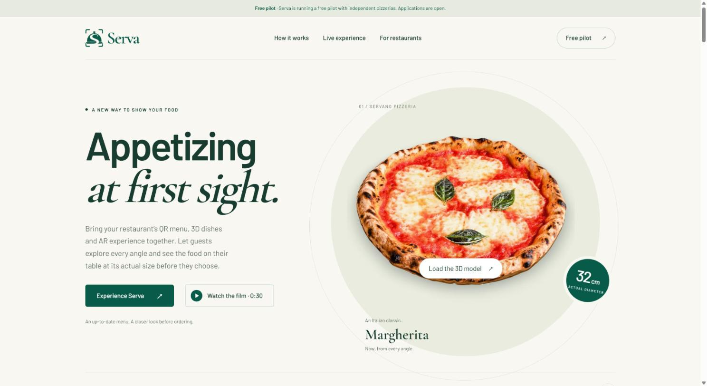
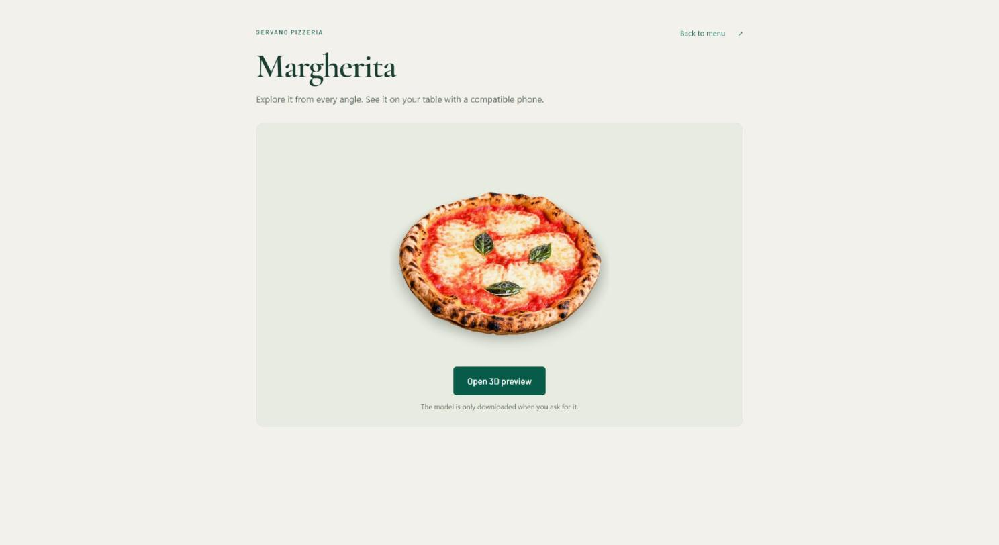
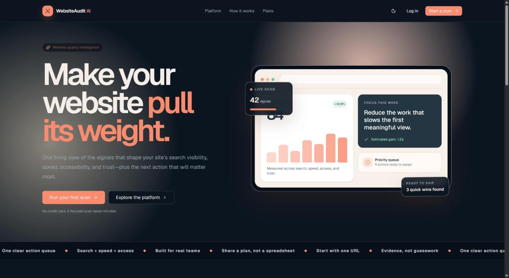
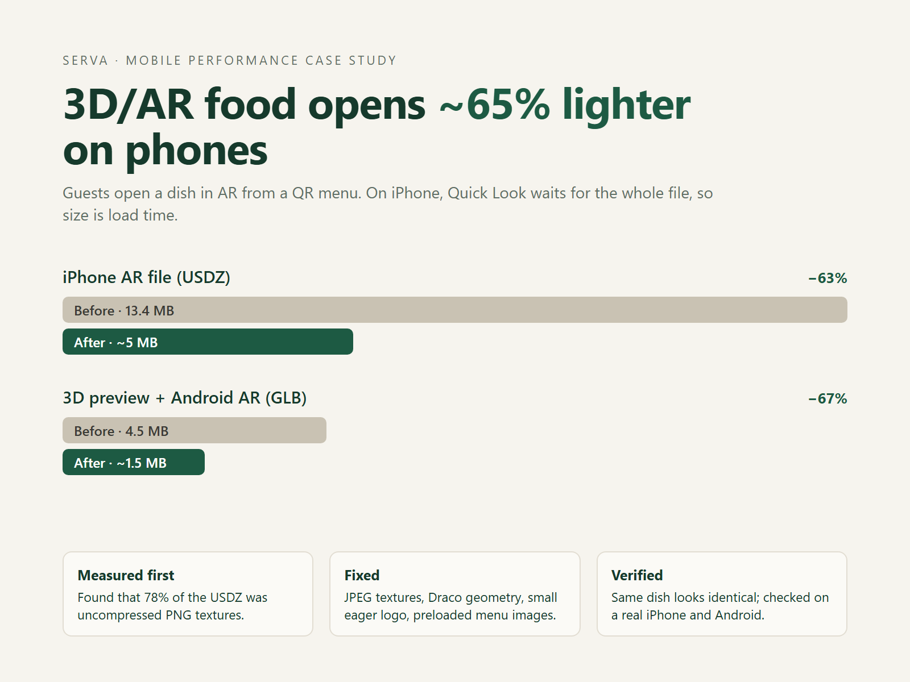

# Barış Aydın

Full-stack developer building web apps with Next.js and TypeScript.

I make fast web apps and ship them end to end: UI, database, auth, deployment. My main project is Serva, a live SaaS for restaurants.

**Stack:** Next.js, React, TypeScript, Tailwind CSS, Prisma, PostgreSQL, Three.js and model-viewer, Cloudflare, Vercel, OpenAI API.

## Projects

### Serva — QR menus with 3D/AR food

[servamenu.com](https://www.servamenu.com) · private repository

A live SaaS for restaurants. Guests scan a QR code and get a multilingual menu, rotate each dish in 3D, and place it on their table in AR at real size on iPhone and Android. Includes an admin panel for the restaurant and an AI menu assistant called Servito.

 

### WebsiteAudit AI

[Source](https://github.com/baristabumbum/websiteaudit-ai) · [Live alpha](https://ai-website-auditor-alpha.vercel.app)

Runs a Lighthouse audit on a site and turns the results into a readable report with prioritized fixes. Next.js, Prisma/PostgreSQL, Clerk, OpenRouter/OpenAI. Alpha status, documented in the README.

### Case study: making 3D/AR files about 65% lighter

On iPhone, AR Quick Look downloads the whole file before it opens, so file size is load time. I measured Serva's AR assets and found that 78% of the USDZ was uncompressed PNG textures. After switching to JPEG textures and Draco geometry, and preloading menu images:

| File | Before | After |
| --- | --- | --- |
| iPhone AR file (USDZ) | 13.4 MB | about 5 MB |
| 3D preview and Android AR (GLB) | 4.5 MB | about 1.5 MB |

The dishes look the same, checked on a real iPhone and Android phone.

## Work with me

Available for freelance work on Upwork: Next.js and React apps, landing pages, bug fixes, MVPs, and 3D/AR product previews.

Website: [servamenu.com](https://www.servamenu.com)
